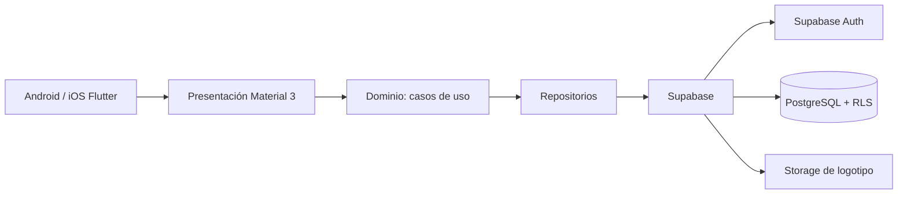

# Arquitectura y navegación

## Diagrama general



## Capas

### Presentación

Pantallas, widgets, formularios, navegación, estados de carga/vacío/error y
adaptación teléfono/tablet. Se evitará duplicar lógica de negocio en widgets.

### Dominio

Entidades inmutables, contratos de repositorio y casos de uso:

- `signIn`, `signUp`, `requestPasswordReset`.
- `listMembers`, `saveMember`, `deactivateMember`.
- `recordAttendance`, `getAttendanceSummary`.
- `saveEvent`, `cancelEvent`, `listUpcomingEvents`.
- `saveMinistry`, `assignMember`.
- `saveDonation`, `getFinancialSummary`.
- `publishAnnouncement`.
- `getDashboardMetrics`.
- `generateMemberReport`, `generateFinancialReport`.
- `updateChurchSettings`.

### Datos

Implementaciones de repositorios, modelos serializables, mapeadores y
clientes Supabase. Las pantallas no accederán directamente al cliente de
Supabase.

### Infraestructura

- Supabase Auth para identidad y recuperación.
- PostgreSQL para datos relacionales.
- RLS para autorización en el servidor.
- Storage privado para logotipo.
- Edge Functions solo cuando una operación requiera privilegios de servidor,
  por ejemplo la generación de reportes financieros.

## Estructura de carpetas propuesta

```text
lib/
  app/
    app.dart
    router.dart
    theme.dart
  core/
    errors/
    result/
    responsive/
    widgets/
  features/
    auth/
    dashboard/
    members/
    attendance/
    events/
    ministries/
    finance/
    announcements/
    reports/
    settings/
    profile/
  data/
    supabase/
  domain/
    entities/
    repositories/
    use_cases/
```

## Navegación móvil

- Flujo no autenticado: bienvenida, login, registro, recuperar contraseña,
  restablecer contraseña.
- Flujo autenticado: `NavigationBar` con Dashboard, Miembros, Eventos y Más.
- `Más` contiene Asistencia, Ministerios, Finanzas, Comunicados, Reportes,
  Configuración y Perfil según permisos.
- Tablet: `NavigationRail` y contenido con ancho máximo.
- Rutas protegidas: redirigen a login si no existe sesión y a una pantalla de
  acceso denegado si el rol no tiene permiso.

## Decisiones de dependencias

- `supabase_flutter`: backend y sesión.
- `go_router`: rutas protegidas y deep links de recuperación.
- `flutter_riverpod`: estado y composición de dependencias.
- `fl_chart`: gráficas del dashboard.
- `pdf` y `printing`: creación y compartir reportes PDF.
- `intl`: fechas, moneda y localización.

Las dependencias se incorporarán solo durante la implementación y se fijarán
por versión en `pubspec.yaml`.
